# InvitaVibra · Invitaciones digitales interactivas

     

**🔗 En producción:** **[invitavibra.pythonanywhere.com](https://invitavibra.pythonanywhere.com)**

Plataforma completa para vender invitaciones digitales en México: bodas, XV años, graduaciones, fiestas y baby showers. Cada invitación es un link que se manda por WhatsApp, con confirmación de asistencia en vivo, cuenta regresiva, música, mapa, galería, y se instala como app.

**No es un proyecto de práctica:** está desplegado con HTTPS y es la base de un negocio real, desde el catálogo que ve el cliente hasta el panel donde el anfitrión ve quién confirmó.

> 🔒 **El código fuente es privado** porque es un producto comercial. Este repositorio es su vitrina: qué hace, cómo está construido, las decisiones técnicas, los problemas que resolví y fragmentos representativos del código. **Si eres reclutador y quieres revisar el código completo, escríbeme y te doy acceso de lectura.**

<p align="center">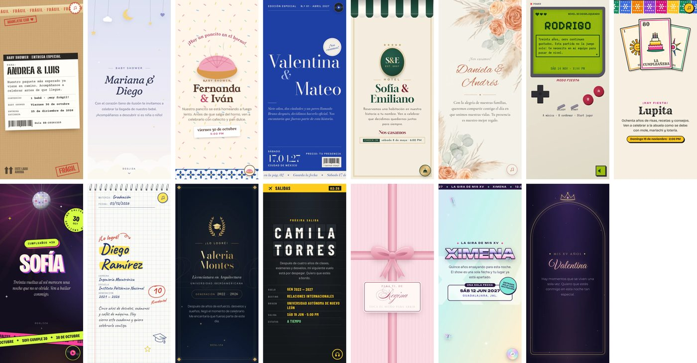</p>

## English summary

Full-stack Django platform, in production, powering a real digital-invitation business in Mexico. One rendering engine plus 20 visual themes; live RSVP and voting (polling), installable PWA with a custom service worker, a client self-service order form, and a private host dashboard with CSV export. Production-hardened: rate limiting with hashed IPs, server-side validation, EXIF/GPS stripping, privacy notice compliant with Mexican law (LFPDPPP), automatic data retention, verified SQLite backups, and 107 automated tests in GitHub Actions. Source is private; read access available on request.

## En 30 segundos

<table><tr>
<td width="38%"><a href="docs/video/frente-al-mar.mp4">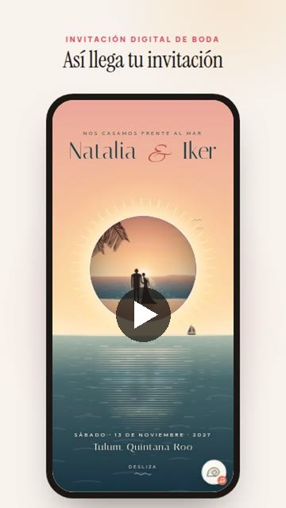</a></td>
<td>

**▶ [Ver el video (33 s)](docs/video/frente-al-mar.mp4)**: una invitación de boda de principio a fin.

O pruébalo tú, mejor en el celular:

- 📒 **[Catálogo con los 20 diseños](https://invitavibra.pythonanywhere.com)**
- 🌅 **[Boda · Frente al Mar](https://invitavibra.pythonanywhere.com/invitaciones/demo-boda-natalia-iker/)**: la foto de los novios es el sol y se pone mientras bajas.
- 🎓 **[Graduación · Mención Honorífica](https://invitavibra.pythonanywhere.com/invitaciones/demo-graduacion-fernando/)**: una tesis empastada que se abre en 3D.
- 🎵 **[XV · Cajita Musical](https://invitavibra.pythonanywhere.com/invitaciones/demo-xv-isabella/)**: dale cuerda y aparece la quinceañera en el espejo.
- 💓 **[Baby shower · Primer Latido](https://invitavibra.pythonanywhere.com/invitaciones/demo-baby-andrea-pablo/)**: el eco en un monitor y su corazón con Web Audio.
- 🎮 **[Fiesta · Nivel Desbloqueado](https://invitavibra.pythonanywhere.com/invitaciones/demo-fiesta-rodrigo/)**: una consola retro con botones que sí funcionan.

En los demos todo funciona: puedes confirmar asistencia, votar "¿niña o niño?" y agendar la fecha.

</td></tr></table>

## Los 20 diseños

Cada uno tiene un concepto propio y está pensado para el cliente que lo compra. Todo el arte es SVG/CSS propio y las tipografías son de licencia libre (OFL). Toca cualquiera para abrir su demo.

**Bodas**

<table><tr>
<td align="center" width="20%"><a href="https://invitavibra.pythonanywhere.com/invitaciones/demo-boda-daniela-andres/">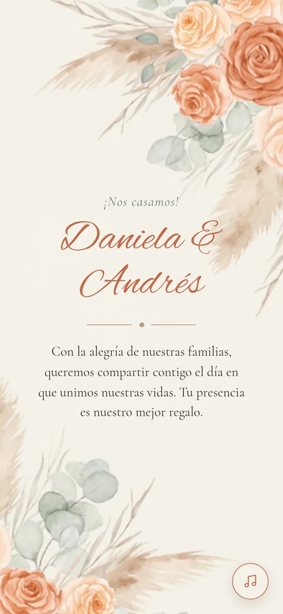</a><br><sub><b>Terracota Velada</b></sub></td>
<td align="center" width="20%"><a href="https://invitavibra.pythonanywhere.com/invitaciones/demo-cobalto-editorial/">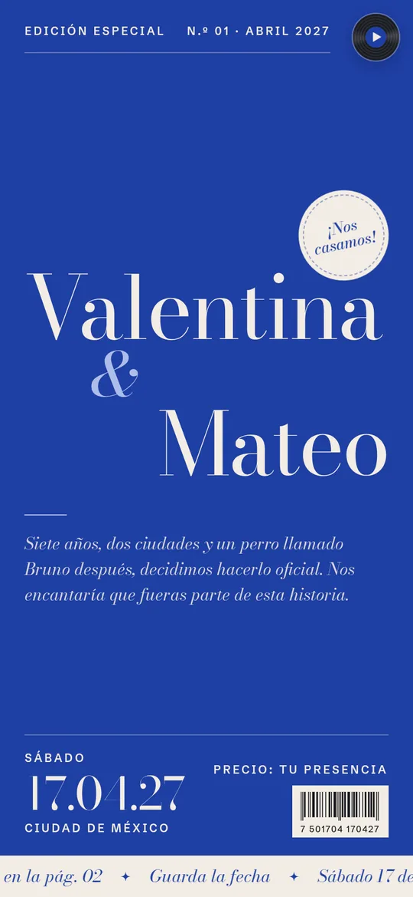</a><br><sub><b>Cobalto Editorial</b></sub></td>
<td align="center" width="20%"><a href="https://invitavibra.pythonanywhere.com/invitaciones/demo-hotel-amor/">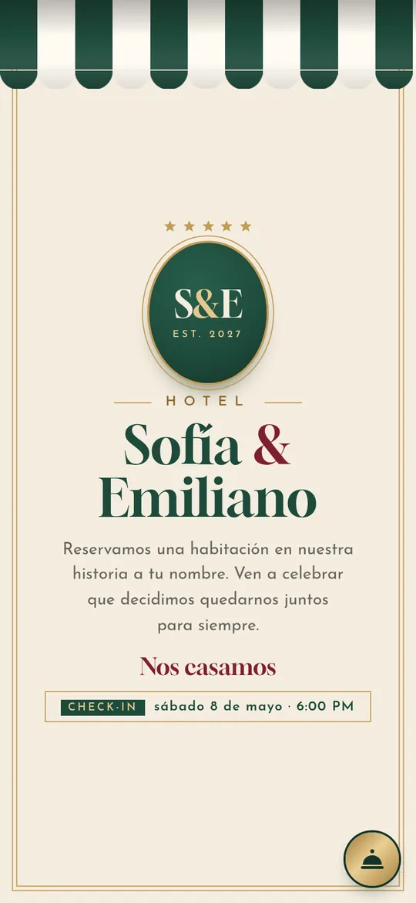</a><br><sub><b>Hotel Amor</b></sub></td>
<td align="center" width="20%"><a href="https://invitavibra.pythonanywhere.com/invitaciones/demo-boda-renata-tomas/"></a><br><sub><b>El Velo</b></sub></td>
<td align="center" width="20%"><a href="https://invitavibra.pythonanywhere.com/invitaciones/demo-boda-natalia-iker/">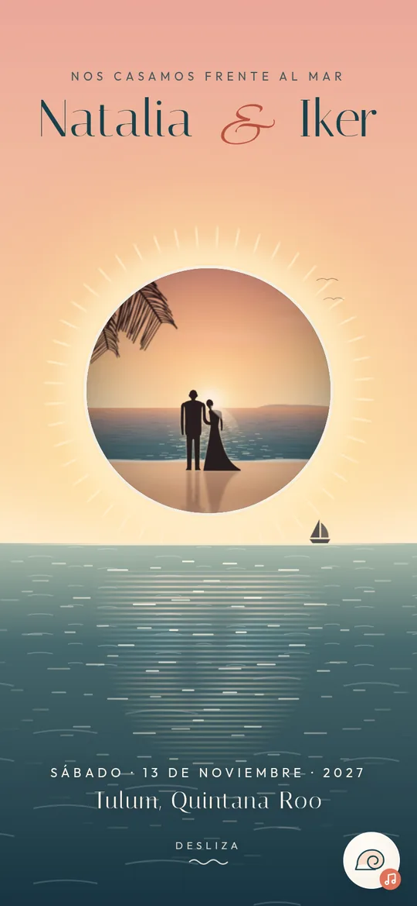</a><br><sub><b>Frente al Mar</b></sub></td>
</tr></table>

**XV años**

<table><tr>
<td align="center" width="20%"><a href="https://invitavibra.pythonanywhere.com/invitaciones/demo-xv-valentina/">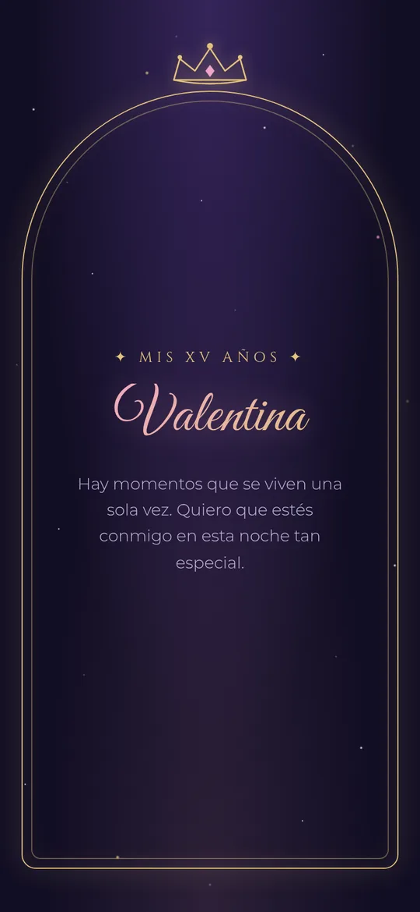</a><br><sub><b>Medianoche Dorada</b></sub></td>
<td align="center" width="20%"><a href="https://invitavibra.pythonanywhere.com/invitaciones/demo-xv-regina/"></a><br><sub><b>Carnet de Baile</b></sub></td>
<td align="center" width="20%"><a href="https://invitavibra.pythonanywhere.com/invitaciones/demo-xv-ximena/">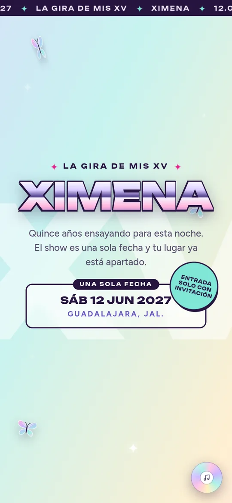</a><br><sub><b>La Gira</b></sub></td>
<td align="center" width="20%"><a href="https://invitavibra.pythonanywhere.com/invitaciones/demo-xv-isabella/">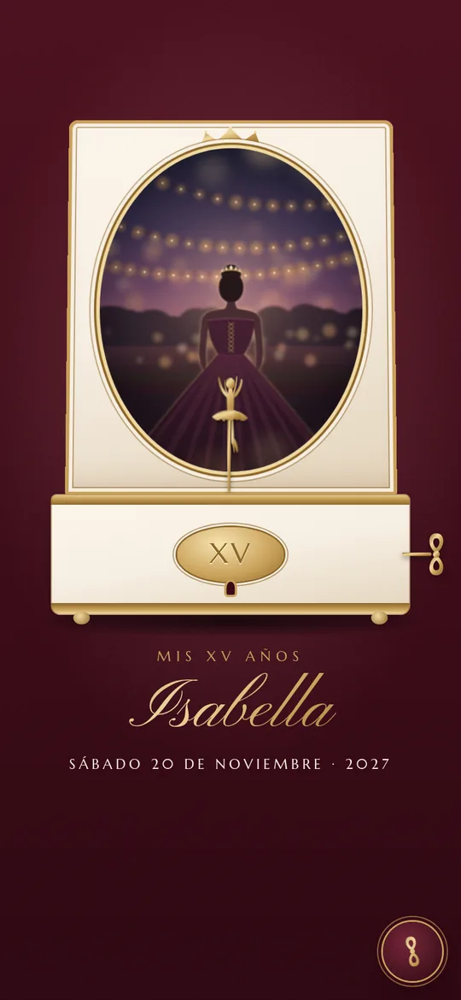</a><br><sub><b>Cajita Musical</b></sub></td>
</tr></table>

**Graduaciones**

<table><tr>
<td align="center" width="20%"><a href="https://invitavibra.pythonanywhere.com/invitaciones/demo-graduacion-valeria-montes/">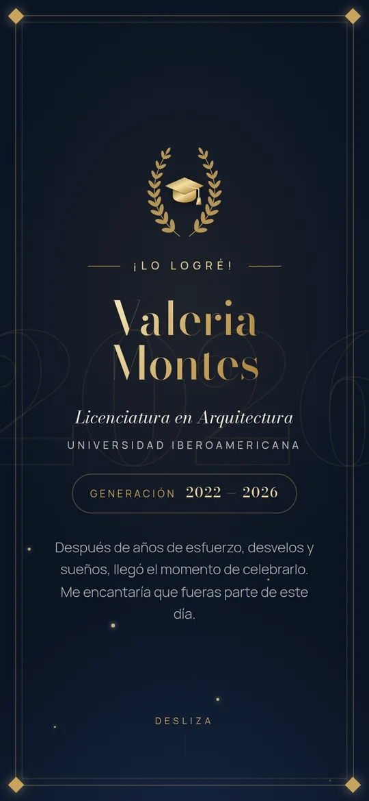</a><br><sub><b>Laurel de Oro</b></sub></td>
<td align="center" width="20%"><a href="https://invitavibra.pythonanywhere.com/invitaciones/demo-graduacion-diego/">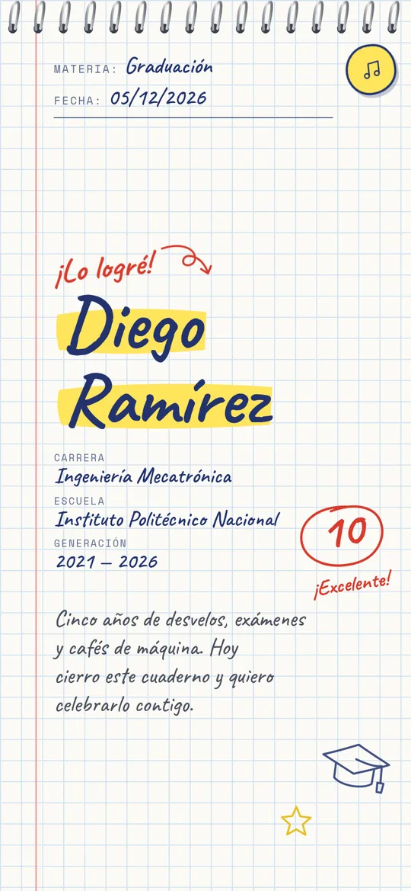</a><br><sub><b>Tarea Cumplida</b></sub></td>
<td align="center" width="20%"><a href="https://invitavibra.pythonanywhere.com/invitaciones/demo-graduacion-camila/">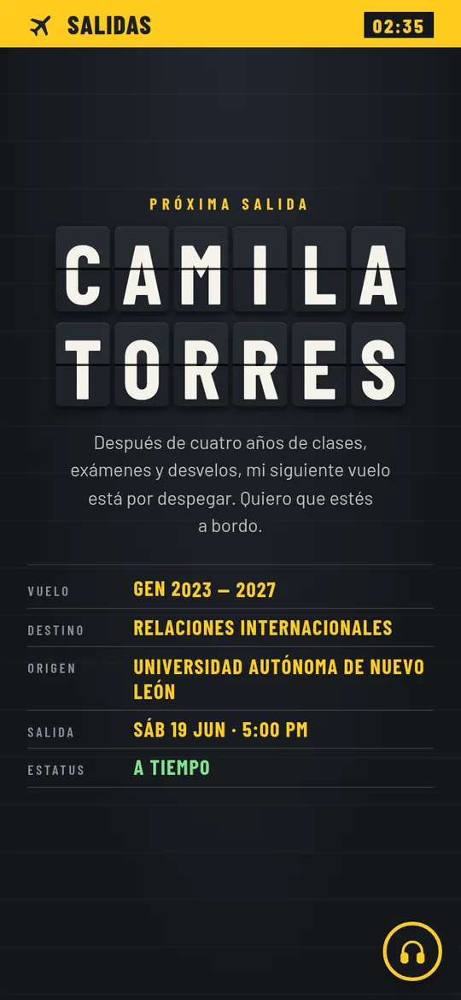</a><br><sub><b>Próxima Salida</b></sub></td>
<td align="center" width="20%"><a href="https://invitavibra.pythonanywhere.com/invitaciones/demo-graduacion-fernando/">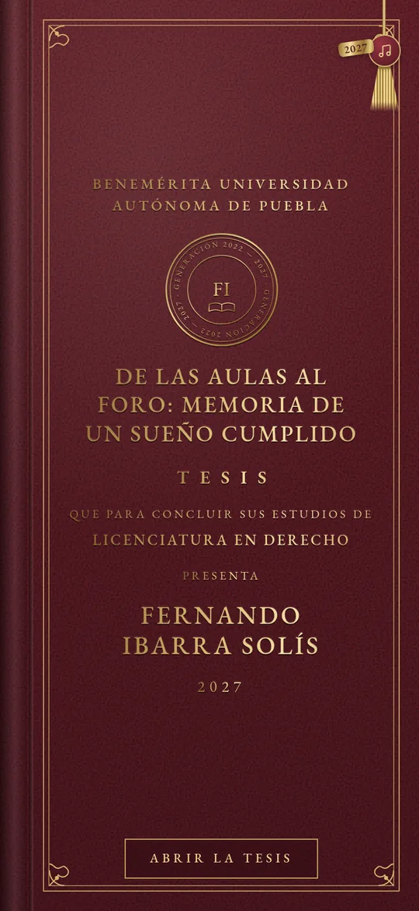</a><br><sub><b>Mención Honorífica</b></sub></td>
</tr></table>

**Fiestas**

<table><tr>
<td align="center" width="20%"><a href="https://invitavibra.pythonanywhere.com/invitaciones/demo-fiesta-sofia/">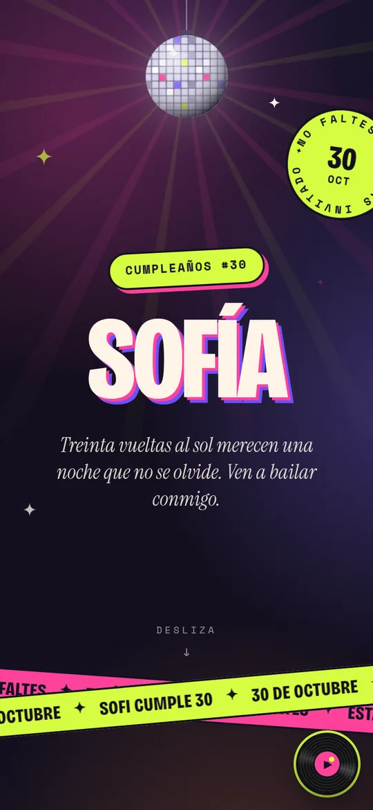</a><br><sub><b>Noche Neón</b></sub></td>
<td align="center" width="20%"><a href="https://invitavibra.pythonanywhere.com/invitaciones/demo-loteria-lupita/">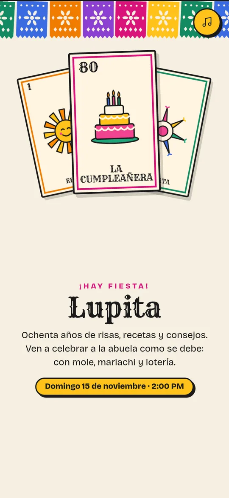</a><br><sub><b>La Lotería</b></sub></td>
<td align="center" width="20%"><a href="https://invitavibra.pythonanywhere.com/invitaciones/demo-fiesta-rodrigo/">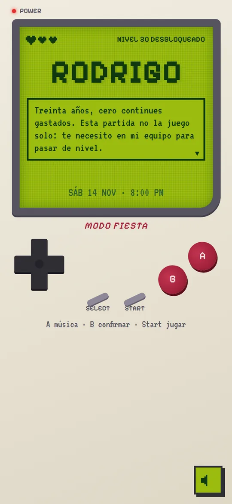</a><br><sub><b>Nivel Desbloqueado</b></sub></td>
</tr></table>

**Baby showers**

<table><tr>
<td align="center" width="20%"><a href="https://invitavibra.pythonanywhere.com/invitaciones/demo-baby-mariana-diego/">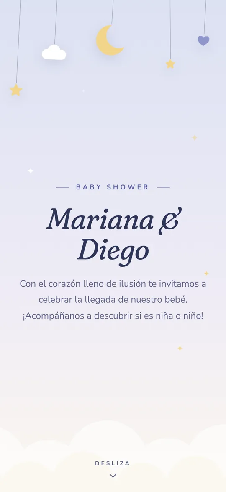</a><br><sub><b>Diez Lunas</b></sub></td>
<td align="center" width="20%"><a href="https://invitavibra.pythonanywhere.com/invitaciones/demo-baby-entrega/">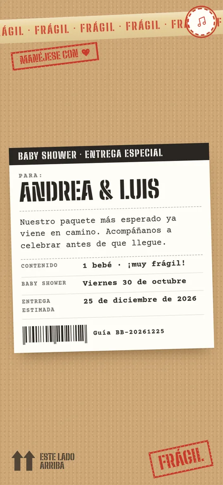</a><br><sub><b>Entrega Especial</b></sub></td>
<td align="center" width="20%"><a href="https://invitavibra.pythonanywhere.com/invitaciones/demo-baby-pancito/">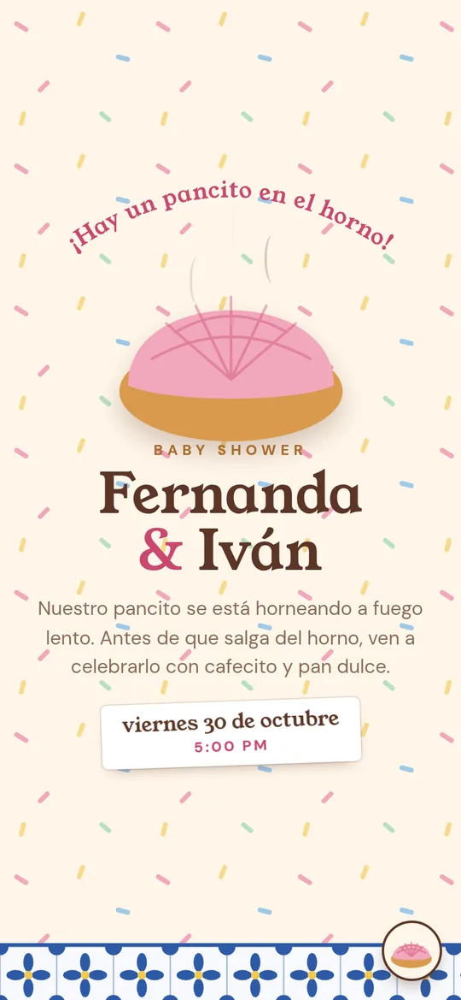</a><br><sub><b>Pancito en el Horno</b></sub></td>
<td align="center" width="20%"><a href="https://invitavibra.pythonanywhere.com/invitaciones/demo-baby-andrea-pablo/">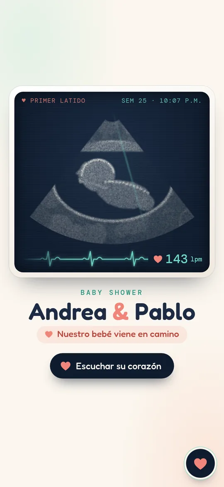</a><br><sub><b>Primer Latido</b></sub></td>
</tr></table>

## Qué resuelve

**Para el invitado**
- Confirmación de asistencia con conteo en vivo, cuenta regresiva, botón a Google Maps, archivo `.ics` para el calendario y música con un toque.
- Juego en vivo "¿Niña o niño?": cuando los papás revelan el resultado, a todos los que tienen la invitación abierta les aparece con confeti.
- **PWA:** se instala en la pantalla de inicio y abre sin señal.

**Para el negocio** (el flujo completo, sin capturar nada a mano)

```
Anuncio → Catálogo → "La quiero" (WhatsApp) → Pedido en el admin → link privado
→ el cliente llena su formulario desde el celular → vista previa con marca de agua
→ pago → publicar → el cliente la comparte → Panel del anfitrión en vivo
```

- **Catálogo** con filtros por evento que viven en la URL (`/#xv`) y botones a WhatsApp con el mensaje ya escrito.
- **Formulario del cliente** que cambia según el evento, el paquete y el diseño, y arma la invitación solo.
- **Panel del anfitrión**: quién confirmó, cuántas personas van, sus mensajes, descarga para Excel y el botón para revelar la votación en pleno evento.

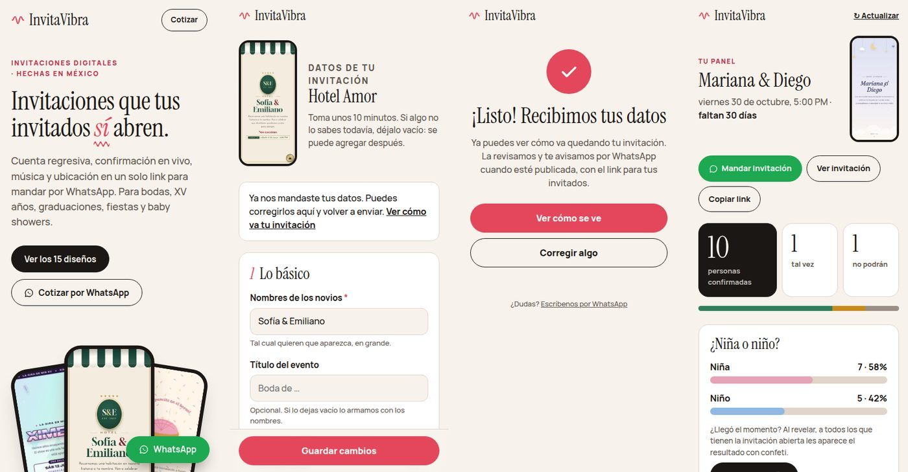

## Cómo está hecho

| | |
|---|---|
| **Backend** | Django 6.1, Python 3.13, SQLite |
| **Frontend** | HTML + CSS + JavaScript vanilla, sin frameworks ni librerías de animación |
| **Tiempo real** | Polling cada 8 s (RSVP, votación y revelación) |
| **Offline** | Service worker propio y manifest generado por invitación |
| **Imágenes** | Pillow: verificación, rotación EXIF, redimensión y borrado de GPS |
| **Producción** | PythonAnywhere, HTTPS (Let's Encrypt), WhiteNoise, logs, respaldos |
| **Calidad** | 107 pruebas unitarias y de integración en GitHub Actions |

**La idea central es un motor + plantillas.** Un solo template base contiene toda la lógica (RSVP, countdown, votación, scroll por pantallas, PWA) y expone bloques. Cada diseño es un archivo que solo cambia estilos y decoración. Un arreglo en el motor lo heredan los 20 diseños a la vez, y un diseño nuevo no puede romper el RSVP.

➡️ **[Arquitectura y decisiones técnicas](docs/ARQUITECTURA.md)**: modelos, el patrón motor + plantillas, niveles de paquete, tiempo real y PWA, con el porqué de cada decisión.

➡️ **[Problemas que resolví](docs/RETOS.md)**: bugs reales encontrados probando en un iPhone, con su causa raíz y la solución.

➡️ **[Fragmentos del código](fragmentos/)**: piezas representativas, tal como están en el proyecto.

## Listo para producción

- Settings separados: `DEBUG=False`, secretos en `.env`, y el sitio no arranca si falta uno.
- **Anti-spam** en confirmaciones y votos: límite por conexión y por invitación (429 + `Retry-After`), con la IP guardada solo como hash.
- Validación del RSVP en el servidor y protección contra doble envío.
- Fotos de clientes verificadas, redimensionadas y **sin datos EXIF/GPS**.
- **Aviso de privacidad** conforme a la LFPDPPP y borrado automático de las respuestas 90 días después del evento.
- **Respaldos** de la base con la API de backup de SQLite, revisión de integridad y rotación.
- Revisiones propias en `manage.py check --deploy`.
- Páginas 404/500 propias, admin en una ruta propia y cookies seguras.
- **Carga ligera:** al abrir una invitación con 12 fotos se bajaban 3 MB; con carga diferida de imágenes y audio, ahora 0.07 MB.

## Cómo lo construí

Construí este proyecto con **[Claude Code](https://claude.com/claude-code)** como herramienta de programación. El reparto fue así:

**Lo que hice yo**
- La idea de negocio: invitaciones interactivas para el mercado mexicano, vendidas por anuncios y WhatsApp, por encima del precio de la competencia.
- Las decisiones de producto: qué tipos de evento cubrir, el flujo completo (catálogo → pedido → formulario → vista previa → publicación → panel), qué ve cada quien y qué incluye cada paquete.
- Dirigir y aprobar cada diseño: pedía un concepto, lo revisaba y pedía cambios hasta que quedaba listo para vender.
- Probar todo en mi iPhone real, primero por WiFi y luego en producción, y reportar lo que fallaba.
- Desplegarlo: hosting, servidor, secretos, HTTPS, archivos estáticos y los errores del despliegue.

**Lo que hizo Claude Code**
- Escribir la mayor parte del código (Django, HTML, CSS y JavaScript) y las pruebas.
- Proponer conceptos de diseño, tipografías y paletas, y explicarme cada decisión técnica para entenderla y poder mantenerla.

Para mí la habilidad está en saber qué construir, para quién, y llevarlo hasta producción. La IA me permitió hacerlo en semanas y no en meses.

---

Hecho por **Fabrizio Espinoza Hurtado** · [GitHub](https://github.com/Fabrizio-Espinoza)

© 2026 Fabrizio Espinoza Hurtado. Todos los derechos reservados: ver [LICENSE](LICENSE).
