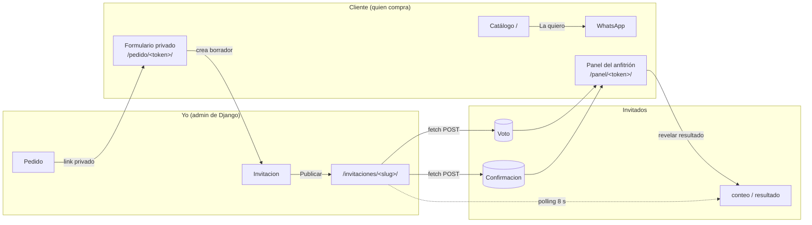

# Arquitectura y decisiones técnicas

[← Volver al inicio](../README.md)

## Vista general



## Modelos

| Modelo | Qué guarda | Por qué así |
|---|---|---|
| `Plantilla` | Un **diseño** reutilizable: tipo de evento, `slug_tema` y qué soporta (RSVP, música, galería, votación). | Separa el diseño de los datos del cliente: 20 diseños sirven a cualquier número de clientes. |
| `Invitacion` | El evento de un cliente: slug público, UUID interno, paquete, datos comunes en columnas y `contenido_extra` (JSON) para lo específico del evento. | Una boda necesita padrinos y una graduación necesita carrera. Con columnas, el modelo crecería sin control con cada tipo de evento; con JSON no hacen falta migraciones. |
| `ImagenGaleria` | Una foto por registro, con orden. | Permite reordenar y subir desde el admin, y maneja el archivo real (`ImageField`), no solo una URL. |
| `Confirmacion` / `Voto` | Una respuesta por registro. | Alimentan el conteo en vivo y el panel del anfitrión. |
| `Pedido` | La venta: cliente, diseño, paquete, token del formulario y notas. | El cliente captura sus propios datos y yo solo reviso y publico. |

**La regla:** lo que aplica a cualquier evento va en columnas reales, que se pueden consultar y validar. Lo que es de un solo tipo de evento va en JSON. El formulario del cliente solo toca sus propias claves del JSON, así lo que agrego a mano en el admin sobrevive a sus correcciones.

## Motor + plantillas

```
base_interactiva.html      ← el motor: estructura, RSVP, countdown, votación, PWA, scroll
 ├── boda-mar-05.html      ← solo , decoración y JS decorativo
 ├── xv-cajita-04.html
 ├── graduacion-tesis-04.html
 └── … (20 diseños)
```

- El motor se escribe **una sola vez**. Un bug o una mejora en el RSVP se arregla en un lugar y la heredan los 20 diseños por ``.
- La vista arma el nombre del template desde `plantilla.slug_tema`. Un diseño nuevo es literalmente un archivo nuevo, sin `if/else` por tipo de evento.
- Los diseños se comunican con el motor por **eventos del DOM**. Por ejemplo, el motor emite `rsvp:enviado` y cada diseño celebra a su manera: una llave de hotel, una pulsera de la amistad con el nombre del invitado, un sello de "Aprobado".
- El JS decorativo de cada diseño corre **después** del motor: si falla, la invitación sigue funcionando.
- Mejora progresiva: sin JavaScript todo el contenido se ve. Las animaciones de apertura (el velo, la cajita, la tesis) nacen con `hidden` y solo el JS las pone.

## Niveles de paquete

La vista cruza el paquete pagado (imagen / interactiva / premium) con lo que soporta el diseño:

```python
"mostrar_rsvp":    invitacion.nivel != "imagen" and invitacion.plantilla.soporta_rsvp,
"mostrar_musica":  invitacion.nivel == "premium" and invitacion.plantilla.soporta_musica,
"mostrar_galeria": invitacion.nivel != "imagen" and invitacion.plantilla.soporta_galeria,
```

Un cliente nunca ve funciones que no pagó, y un diseño nunca pinta una sección que no sabe dibujar.

## Tiempo real: polling en vez de WebSockets

El conteo de confirmaciones, la votación y la revelación del resultado se actualizan con **polling cada 8 segundos**.

- Para una invitación, 8 s de retraso es imperceptible.
- Funciona en cualquier hosting WSGI barato, sin Django Channels, Redis ni procesos extra.
- Es el único punto que cambiaría si el negocio necesitara algo instantáneo de verdad.

## PWA

- **Manifest generado por invitación** (`/<slug>/manifest.webmanifest`): nombre, ícono del diseño, colores y `scope` propio. Cada invitación se instala como su propia app.
- **Service worker** con estrategias distintas: red primero para el HTML (para que siempre salga la versión más nueva) y caché primero para imágenes y fuentes. Nunca cachea `/rsvp/`, `/votar/`, peticiones POST ni audio por rangos.
- Íconos de 180, 192 y 512 px por diseño, más las etiquetas que pide el iPhone.

## Rendimiento

- Fotos de la galería con `loading="lazy"` y `decoding="async"`; audio con `preload="none"` (la canción pesa ~7 MB y solo se baja al tocar play).
- Medido con 12 fotos: la carga inicial pasó de **3 MB a 0.07 MB**.
- Las fotos de los clientes se reducen a 1600 px y JPEG calidad 82: ~170 KB cada una.
- `select_related` / `prefetch_related` para traer invitación, diseño y galería en una sola consulta.

## Seguridad y privacidad

- **Rate limit** propio sobre la caché de Django: por conexión y por invitación, con la IP guardada solo como hash con la `SECRET_KEY` ([ver código](../fragmentos/limite_de_envios.py)).
- La IP real se lee de la cabecera del balanceador del hosting y nunca del `X-Forwarded-For` completo, que el visitante puede falsificar.
- Validación del RSVP en el servidor (no solo en el navegador) y deduplicación de envíos repetidos.
- Fotos verificadas con Pillow y sin EXIF/GPS ([ver código](../fragmentos/fotos_de_clientes.py)).
- Tokens al azar para el formulario y el panel, distintos del slug público, con `noindex` y `no-store`.
- Aviso de privacidad conforme a la LFPDPPP y borrado programado de los datos 90 días después del evento.
